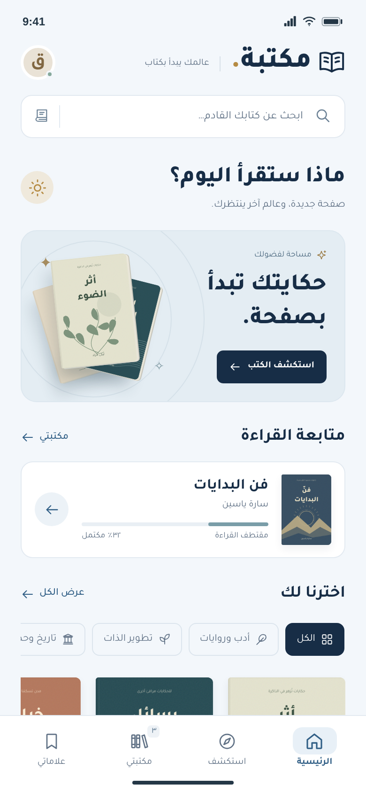
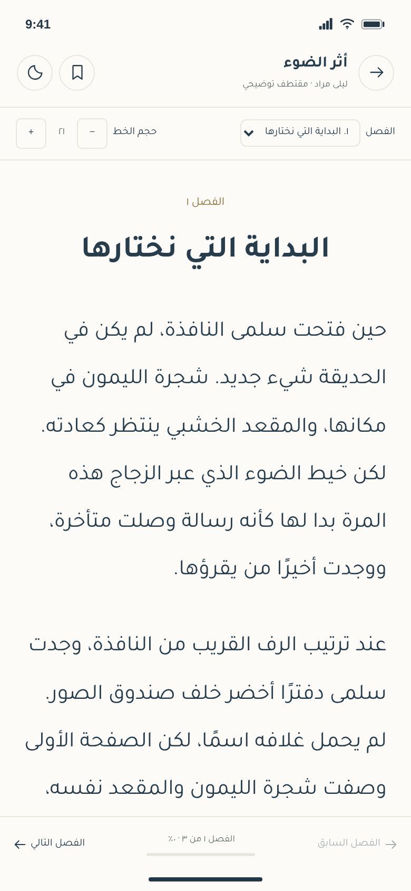
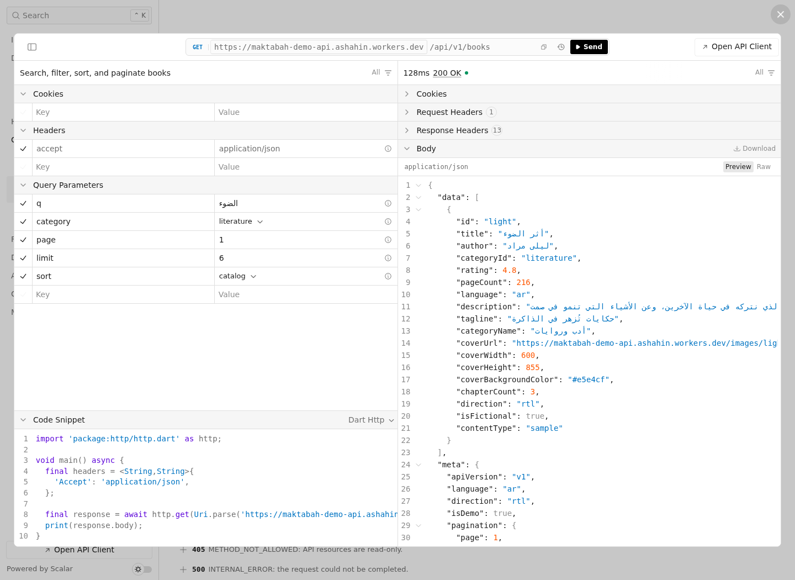

# مكتبة · Maktabah

An Arabic library app prototype with a public demo API for Flutter. Discover books, read original Arabic sample chapters, and keep saved books, bookmarks, reading progress, and preferences on your device.

Built with **Hono**, **Cloudflare Workers**, **Bun**, and **Scalar**. The web prototype supports Arabic RTL layouts on mobile and desktop.

## Live demo

| Resource | Link |
| --- | --- |
| App on Cloudflare Pages | [maktabah-prototype.pages.dev](https://maktabah-prototype.pages.dev) |
| Interactive API reference | [Browse docs and try requests](https://maktabah-demo-api.ashahin.workers.dev/docs) |
| Public API base | `https://maktabah-demo-api.ashahin.workers.dev/api/v1` |
| OpenAPI 3.1 contract | [Download JSON](https://maktabah-demo-api.ashahin.workers.dev/openapi.json) |

No API key is required. The API is read-only and supports CORS for Flutter web. The catalog contains **12 fictional books**, **4 categories**, **36 original sample chapters**, and matching self-hosted cover images. Authors, ratings, and full-book page counts are illustrative.

## Screenshots

### Library home


### Mobile and reader

| Mobile home | Arabic chapter reader |
| --- | --- |
|  |  |

### Interactive API docs



## Run locally

```sh
cd api
bun install --frozen-lockfile
bun run dev
```

Open `http://127.0.0.1:8787/docs` for the interactive API reference. To preview the app in another terminal:

```sh
cd api
bunx wrangler pages dev ../prototype --port 48763
```

Open `http://localhost:48763`. The prototype uses the public Worker configured in [`prototype/api-config.js`](prototype/api-config.js). For a local backend, follow the [prototype setup guide](prototype/README.md).

## Use in Flutter

Add `http` with `flutter pub add http`, then copy the [Dart API client](api/examples/maktabah_api.dart) into your app:

```dart
final api = MaktabahApi(
  origin: 'https://maktabah-demo-api.ashahin.workers.dev',
);
final page = await api.getBooks(q: 'الضوء', category: 'literature');
```

The API returns UTF-8 Arabic JSON, absolute `coverUrl` values for `Image.network`, pagination metadata, and clear error codes. Chapter indexes start at **0**. User state stays in local storage; `/api/v1/demo-state` provides an optional initial seed.

See the [API and Flutter integration guide](api/README.md) for endpoints, response fields, and error handling.

## Verify and deploy

Run these commands from `api/`:

```sh
bun run check
bun run smoke https://maktabah-demo-api.ashahin.workers.dev
bun run docs:test https://maktabah-demo-api.ashahin.workers.dev
bun run prototype:test https://maktabah-prototype.pages.dev
```

```sh
bunx wrangler login
bunx wrangler deploy
bun run pages:deploy
```

[`api/wrangler.jsonc`](api/wrangler.jsonc) targets the Personal Cloudflare account used for this demo. Set your own `account_id`, Worker name, Pages project, and API base when deploying a fork. Wrangler prepares the bundled Scalar assets automatically before development and deployment.

Refresh the screenshots with:

```sh
bun scripts/capture-screenshots.mjs https://aashahin.github.io/maktabah/ https://maktabah-demo-api.ashahin.workers.dev
```

The [API source](api/src), [JSON fixtures](api/data/catalog.json), and [web prototype](prototype) are included in this repository.
